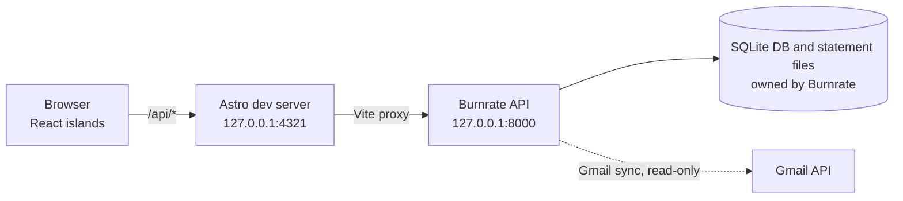

# CardOS system context

- **Purpose:** Verified description of how CardOS is built and how it talks to Burnrate, so an agent can work without re-reading the repo.
- **Audience:** AI coding agents and the maintainer.
- **Owner:** The maintainer.
- **Related docs:** [AGENTS.md](../AGENTS.md) · [INDEX](INDEX.md) · [ADR 0001](decisions/0001-local-burnrate-patch.md) · [README](../README.md) · [CURRENT](CURRENT.md)
- **How to validate:** `file:line` references hold at the commit in the footer. Re-check with `grep -rn "/api/" src/` (endpoints), `sed -n '58,66p' src/lib/live.ts` (cadence) and `astro.config.mjs` (ports).

## Runtime topology

CardOS is a frontend only: no database and no server-side data fetching. Astro renders page shells and React islands call `/api/*` from the browser.

- Host and port: `astro.config.mjs:20-21`. `strictPort: true` (`:10`) makes a busy port an error. The `/api` proxy targets `http://127.0.0.1:8000` (`:13-14`).
- The launcher always runs `astro dev` (`scripts/start-cardos.mjs:133`). The proxy lives under `vite.server`; whether `npm run preview` proxies is unverified.
- The Burnrate URL and both ports are hardcoded in three places: `astro.config.mjs`, `scripts/start-cardos.mjs:9-10,123,133,149`, `scripts/configure-gmail.mjs:8-10`. Change them together.
- Locked stack (`package-lock.json`): Astro 7.4, React 19.3, Tailwind 4.3, TypeScript 5.9; the Phase 11 branch pins all direct dependencies to these resolved versions. `npm test` runs Vitest 5.0.4 over `src/lib`; `docs:test` tests the documentation checks; `npm run check` (`astro check`) is the type check. No lint script exists.

## Module map

Every page renders inside `src/layouts/AppShell.astro` (sidebar and mobile nav, theme toggle, `BurnrateStatus` in the top bar); all but `/more` mount one React component. Components hydrate with `client:load`, except `CardDetail` (`client:only="react"`), which reads `?id=` from `window.location.search` (`CardDetail.tsx:7`).

| Route | Page (`src/pages/`) | Component (`src/components/`) | Live data it reads |
|---|---|---|---|
| `/` | `index.astro` | `Dashboard` | cards, summary, dues, trends, categories, transactions, statements |
| `/cards` | `cards.astro` | `CardsView` | cards, summary, dues |
| `/cards/detail?id=` | `cards/detail.astro` | `CardDetail` | cards, summary, dues, transactions, statements |
| `/bills` | `bills.astro` | `BillsView` | dues, cards |
| `/analytics` | `analytics.astro` | `AnalyticsView` | summary, trends, categories, merchants |
| `/transactions` | `transactions.astro` | `TransactionsView` | cards, categories, a paged transactions query |
| `/statements` | `statements.astro` | `StatementsView` | statements, processing logs; unlock mutation |
| `/fees` | `fees.astro` | `FeeOptimizerView` | cards, milestones |
| `/milestones` | `milestones.astro` | `MilestonesView` | milestones, cards |
| `/offers` | `offers.astro` | `OffersView` | offers |
| `/settings` | `settings.astro` | `SettingsView` | settings, Gmail status; settings and Gmail mutations |
| `/more` | `more.astro` | none (static links; the mobile nav's "More") | none |

Shared: `BurnrateStatus` (connection pill, Sync button, Gmail connect and sync) also calls `startLiveSync()` (`BurnrateStatus.tsx:12`), so live sync runs on every page. `LineChart` is an SVG chart used by Dashboard and Analytics. Styles: `global.css` (AppShell), `optimize.css` (Milestones, Offers, Settings), `statements.css` (Statements).

- `src/lib/api.ts`: types (`Card`, `DueItem`, `Transaction`, `Statement`, which carries both snake_case and camelCase fields); `apiGet` with an 8 s timeout (`:8`); INR and `en-IN` formatting; IST dates (`Asia/Kolkata`, `:24`), reading timezone-less timestamps as UTC (`:31-37`); `upcomingDues` merges Burnrate dues with manual card due dates (`:73`); `bankLabel`, `bankClass` (`:86-87`).
- `src/lib/live.ts`: shared in-memory store, polling, hooks and `apiMutate` (next section).
- `src/lib/gmail.ts`: `connectGmail` (POST `/api/gmail/auth/start`; follows only an `accounts.google.com` URL, `:13-14`), `syncGmail` (180 s timeout, `:22`), `gmailNeedsReconnect` (401 or token-error text, `:17-20`).

## Data flow

Components never call `fetch`: they read through `live.ts` hooks and write through `apiMutate`. The only `fetch` calls are `api.ts:10` (`apiGet`, used only by `live.ts`), `live.ts:169` and `gmail.ts:9`.

- **Read:** `useLiveData(path)` reads the shared store (`live.ts:134`). `refreshAll` (`:94-123`) fetches the 11 core `endpoints` (`:4-16`) together. `useLiveQuery(path)` (`:138`) handles dynamic paths: it fetches on mount and joins every later `refreshAll` while mounted.
- **Failure handling:** one in-flight request per path (`:39`) and one running refresh (`:95`). A failed path keeps its old data and gets `error: true` (`:112`). Connection state is `offline` if `/api/settings` fails, `error` if only other paths fail (`:116-119`).
- **Storage:** API data stays in memory (`entries`, `:20`); the only browser storage is the `localStorage` key `cardos-theme` (`AppShell.astro:50,59`).

| Trigger | Behaviour | Where |
|---|---|---|
| Page load | `startLiveSync()` runs once, then `refreshAll('startup')` | `live.ts:125-128` |
| Focus or tab visible | `focus` and `visibilitychange` call `refreshAll('focus')` unless hidden | `live.ts:129-131` |
| Periodic | Full refresh every 45 s while visible; no timers while hidden | `live.ts:61-62` |
| After failures | Delay `min(60 s, 5 s × 2^min(n,4))`: 10, 20, 40, then 60 s | `live.ts:62` |
| Processing poll | Every 5 s, statements and processing logs only, while any row is `processing`, `pending`, `queued` or `parsing` and there are no failures. A changed fingerprint triggers a full `refreshAll('change')` | `live.ts:52-56,63-65,68-92` |
| Manual | Sync button calls `refreshAll('manual')` | `BurnrateStatus.tsx:23` |
| After a mutation | `apiMutate` awaits any running refresh, then `refreshAll('mutation')` | `live.ts:183-184` |

From reading the code (not observed at runtime): every 5 s poll ends in `schedule()`, which re-arms the 45 s timer, so the 45 s full refresh is deferred while any row is in a processing status.

**Mutations:** `apiMutate(path, method, body?, {timeoutMs?})` (`live.ts:164-186`) sends JSON (20 s default, `:166`) and throws `ApiMutationError(status, detail)` on a non-2xx response. Call sites: `PUT /api/settings` (`SettingsView.tsx:58`), `POST …/reparse-with-password` (`StatementsView.tsx:23`, 60 s), `POST /api/gmail/sync` (`gmail.ts:22`, 180 s). `connectGmail` calls `fetch` directly, so it triggers no refresh. After Google sign-in, Burnrate redirects to `/settings?gmail=connected|error` and `SettingsView` runs the first sync (`:45-48`).

## Burnrate endpoints CardOS calls

From `grep -rn "/api/" src/`; all are relative paths proxied to Burnrate.

| Path | Method | Used by |
|---|---|---|
| `/api/settings` | GET, PUT | `live.ts:5`; `SettingsView.tsx:58` |
| `/api/cards` | GET | `live.ts:6` |
| `/api/statements?limit=200&sort_by=period_end&sort_order=desc` | GET | `live.ts:7` |
| `/api/statements/processing-logs?unread_only=false` | GET | `live.ts:8` |
| `/api/statements/{id}/reparse-with-password` | POST | `StatementsView.tsx:23` |
| `/api/transactions?limit=250&sort_by=date&sort_order=desc` | GET | `live.ts:9` |
| `/api/transactions?limit=50&offset=…` plus optional filters | GET | `TransactionsView.tsx:19-31` |
| `/api/analytics/summary`, `/trends`, `/categories`, `/merchants` | GET | `live.ts:10-13` |
| `/api/due-reminders?local_date=<IST date>` | GET | `live.ts:15` |
| `/api/milestones` | GET | `MilestonesView.tsx:24`, `FeeOptimizerView.tsx:8` |
| `/api/offers` | GET | `OffersView.tsx:23` |
| `/api/gmail/status` | GET | `live.ts:14` |
| `/api/gmail/auth/start`, `/api/gmail/sync` | POST | `gmail.ts:9`, `gmail.ts:22` |

The scripts also call `/api/settings` (`start-cardos.mjs:9`) and `/api/gmail/status` (`configure-gmail.mjs:8`). `/api/gmail/oauth/callback` appears only as the OAuth redirect URI (`configure-gmail.mjs:9`).

## Operational scripts

- **`npm run cardos`** (`package.json:9`; also `start-cardos.command`) runs `scripts/start-cardos.mjs`:
  1. Burnrate is ready when `GET /api/settings` returns JSON with a `settings` key (2.5 s timeout, `:16-33`). If not, it checks that the Homebrew formula is installed, runs `brew services start`, waits up to 30 s, then `restart` and waits up to 30 s more, else fails (`:79-114`).
  2. CardOS counts as running when `127.0.0.1:4321` answers with a body containing "CardOS"; any other listener is an error. If nothing listens, it starts `astro dev` detached, logging to `cardos-astro.log` in the OS temp dir (mode 600), and waits up to 45 s (`:35-44,116-153`). It needs `node_modules` (`npm ci` first).
  3. It opens the browser unless `CARDOS_NO_OPEN=1` (`:161-162`).
- **`npm run gmail:setup [-- <client.json>]`** runs `scripts/configure-gmail.mjs`:
  1. Finds Burnrate's env file: `BURNRATE_ENV_FILE`, else `libexec/.env.production` under the Homebrew prefix (`:38-47`).
  2. Reads the Google OAuth client from the downloaded JSON (a `web` client must list the callback URI, `:83`) or prompts for the ID and a hidden secret, then validates both (`:123-124`).
  3. Upserts four keys (client ID, client secret, success and error redirects to `/settings?gmail=…`) with mode 600 (`:97-107,126-131`).
  4. Restarts the Burnrate service (skipped with `CARDOS_NO_RESTART=1`) and polls `/api/gmail/status` for up to 30 s until `configured` is true (`:134-143`).
- Other npm scripts: `dev` and `start` (`astro dev`), `build` (`astro check`, then `astro build`), `preview`, `check`, and `test` (Vitest on `src/lib`). Astro scripts set `ASTRO_TELEMETRY_DISABLED=1`.
- AI engineering scripts: `ai:worktree` creates isolated agent tasks; `ai:models` checks the installed Claude and Codex catalogs; `docs:routes` generates the Astro route inventory, `docs:routes:check` detects stale output, `docs:links` checks local Markdown links, `docs:impact` reports path-based review prompts, and `docs:test` checks the documentation tools. These documentation commands do not read the Burnrate service or its data.

## External dependency

Burnrate (FastAPI and SQLite, per the README) is the finance engine, installed through Homebrew (formula name: `formula` in `scripts/start-cardos.mjs:11`). This repo targets Burnrate 0.5.2, from the patch filename and README. A local patch set in `patches/` fixes its Gmail sync, bank detection, password handling and non-card PDF handling, and adds a Standard Chartered parser: see [ADR 0001](decisions/0001-local-burnrate-patch.md). `brew upgrade burnrate` removes the patches and Burnrate's env file; follow the README's re-apply steps, which cover only `burnrate-0.5.2.patch` (see ADR 0001 for the second patch).

## Not in this repo

Burnrate's SQLite database, its `.env.production` (Google OAuth client credentials and the optional `BURNRATE_IGNORE_FILENAME_REGEX`), the statement PDFs and the watch folder. `.gitignore` excludes `.env*`, databases, `*.pdf`, `*.csv` and similar exports.

Last validated: app architecture 2026-10-18 at commit e7598889; documentation tooling and local test command 2026-10-19; direct dependency pins 2026-10-20 on the Phase 11 branch.
