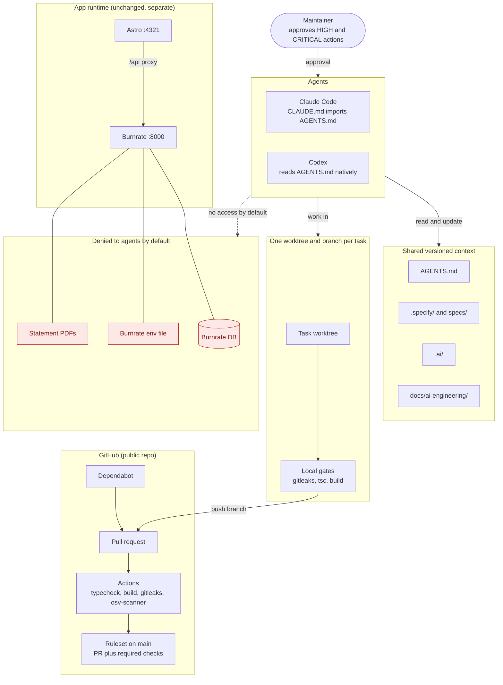

# Implementation Roadmap

- **Purpose:** The durable plan for the AI Engineering OS: profile and rationale, tool decisions, target architecture, the 12 phases with acceptance criteria, security implications, overhead and rollback. It is the long-lived form of the Phase 1 audit.
- **Audience:** The maintainer and the coding agents (Claude Code, Codex).
- **Owner:** The maintainer.
- **Related docs:** [README](README.md) · [PHASE-STATUS.md](PHASE-STATUS.md) · [AGENTS.md](../../AGENTS.md) · [.ai/CONTEXT.md](../../.ai/CONTEXT.md) · [ADR 0001, the decision record for the local Burnrate patch](../../.ai/decisions/0001-local-burnrate-patch.md)
- **How to validate:** Re-run the Phase 1 checks in [section 2](#2-baseline) and compare. Tool versions and licenses are a snapshot from 2026-10-17, so re-check each one before installing it. Each phase's criterion here matches its entry in [PHASE-STATUS.md](PHASE-STATUS.md). Preview the Mermaid diagram on GitHub.

**This file holds the plan, not the status.** Status and evidence live only in [PHASE-STATUS.md](PHASE-STATUS.md).

Facts in sections 1 to 4 come from the Phase 1 audit, a read-only review completed on 2026-10-17, unless a row says otherwise.

## 1. Profile and rationale

**Profile: CORE, scaled to the repo.** The PRODUCTION and SCALE profiles are mostly not applicable.

- CardOS is a local-first frontend with no backend and no deployment. It proxies `/api` to Burnrate, a separate local service ([ADR 0001](../../.ai/decisions/0001-local-burnrate-patch.md)). Deployment, infrastructure and service tooling would have nothing to act on.
- Two agents, Claude Code and Codex, edit one repo, and before Phase 2 they shared no repo instructions. That is the real risk here, so the effort goes into shared context, task isolation and guardrails.
- The repo is public. Everything added here is published, so secret and data hygiene come first.
- The app is small, so "scaled" means text files, built-in features and small scripts before any new tool or service.

Principles that follow from this:

1. Reuse built-in features before adding tools: `AGENTS.md`, git worktrees, agent hooks and permissions, GitHub rulesets, Actions and Dependabot.
2. Pin versions. No `curl | sh` installers.
3. A status changes only with recorded evidence.
4. No real financial or personal data in fixtures, evals, memory or docs.
5. Hooks and deny rules are defense in depth, not a sandbox.

## 2. Baseline

### Repo

| Area | Finding |
|---|---|
| Stack | Astro 7.4, React 19.3, Tailwind 4.3, TypeScript 5.9 |
| Size | 12 pages, 13 components, 3 lib modules; about 1,300 non-blank lines across `src/`, `scripts/` and config (recounted for this document) |
| Backend | None. It proxies to Burnrate (local FastAPI and SQLite, installed with Homebrew, version 0.5.2, patched locally) |
| Controls | One branch (`main`) with no branch protection (the GitHub API returns "Branch not protected"); no CI, no git hooks, no tests, no linter, no formatter |
| Dependencies | Runtime dependencies are declared as `latest`; the lockfile pins the installed versions |

### Evidence (collected 2026-10-17)

| Check | Result |
|---|---|
| gitleaks 8.27.2 over the full git history and the working tree | No leaks (exit 0) |
| Targeted search of all commits for the maintainer's personal identifiers | 0 hits |
| `npm audit` | 0 vulnerabilities |
| `npx tsc --noEmit` | Exit 0 |
| gitleaks full scan time | 0.08 s |
| Serena (code-navigation MCP server, used by Codex) memory | About 50 MB resident across its processes |
| Adoption matrix (versions, licenses, activity) | Verified with the GitHub API |

The gitleaks, typecheck and build commands are listed in [`AGENTS.md` §2](../../AGENTS.md#2-commands).

### Agents

- Claude Code 2.1.245 and Codex CLI 0.159.2.
- Codex reads `AGENTS.md` natively. Claude Code reads `CLAUDE.md`, which imports `AGENTS.md`.
- Both run their premium model at high effort for every task.
- Before Phase 2 they shared one MCP server (headroom, context compression) and no repo instructions.

### Incident behind the multi-agent rules

The two agents edited one working tree. One agent's commit swept in the other's uncommitted edit, so `main` did not build until a later commit fixed it. The plan answers this in three steps: written rules (Phase 2: stage explicit paths and use one worktree and branch per task, in [`AGENTS.md` §6](../../AGENTS.md#6-multi-agent-rules)), tooling that makes the rules easy to follow (Phase 4: a worktree helper and recorded ownership), and required checks on `main` (Phase 5).

## 3. Adoption matrix

Versions, licenses and activity were verified with the GitHub API on 2026-10-17. Rows are grouped by verdict.

| Tool | Version and license (verified 2026-10-17) | Verdict | Reason |
|---|---|---|---|
| GitHub Spec Kit | v1.2.1, MIT. Installed: 0.16.1.dev0, 24 releases behind | ADOPT (upgrade, Phase 3) | Claude `/speckit-*` and Codex `$speckit-*` commands; both integrations are multi-install safe |
| Serena | v2.0.0, GPL-3.0 (app) | ADOPT (keep; add to Claude; pin v2) | Already Codex's code navigator; supports TS, TSX and Astro; the GPL license is fine for local use |
| gitleaks | MIT. Installed 8.27.2; latest 8.30.1 | ADOPT | Secret scanning in pre-commit and CI; a full scan took 0.08 s |
| osv-scanner | v2.7.0, Apache-2.0 | ADOPT | Lockfile vulnerability scan |
| Built-in features: `AGENTS.md`, git worktrees, Claude and Codex hooks and permissions, GitHub rulesets, Actions, Dependabot | Built in | ADOPT | Reuse before adding tools |
| Opengrep | v1.31.0, LGPL-2.1 | PILOT (Phase 5) | Static analysis in CI |
| Conftest / OPA | Apache-2.0 | PILOT (Phase 5) | Validate the few structured configs added |
| Promptfoo | 0.124.1, MIT | PILOT (Phase 9) | Agent benchmark tasks on redacted fixtures |
| ai-memory | v3.1.0, MIT | DEFER (Phase 6) | Markdown-backed, but its default hooks capture prompts and tool calls; start with git-versioned `.ai/` handoffs |
| harness-kit | MIT | DEFER | 0 stars, 1 contributor, pre-1.0, no releases; built-in hooks plus a small verify script cover the need |
| codebase-memory-mcp, code-review-graph, graphify | MIT (upstream), MIT (upstream), Apache-2.0 | DEFER | Overlap with Serena. codebase-memory-mcp runs an always-on daemon and auto-configures agents; graphify sends non-code docs to any API key it finds |
| Renovate | AGPL-3.0 | DEFER → Dependabot | One npm manifest; Dependabot is built in |
| Langfuse, Grafana, Prometheus, OpenTelemetry Collector | Not recorded | DEFER (Phase 10) | No telemetry source yet |
| agentgateway | Not recorded | DEFER | All MCP servers are local stdio |
| GitNexus | PolyForm Noncommercial | REJECT | Noncommercial license; auto-writes agent files and hooks; the listed repo is a stale fork |
| CodeGraph | Not recorded | REJECT | PostHog telemetry in wrappers, 1.5 GB model download, single maintainer |
| OmniRoute | Not recorded | REJECT | Routes prompts to many third-party providers; both CLIs switch models natively |
| The maintainer's forks of codebase-memory-mcp, OmniRoute and code-review-graph | n/a | REJECT as install sources | 0 commits ahead, 1,077 to 3,291 behind upstream |
| OpenTofu, Argo CD/Rollouts, Cosign, k6, Litmus, Backstage | Not recorded | NOT APPLICABLE | No deployment, infrastructure or services |

What the verdicts mean:

- **ADOPT:** use it. The phase in brackets says when.
- **PILOT:** try it in one bounded phase, and keep it only if the recorded result justifies it.
- **DEFER:** not now. Revisit when the stated phase or condition arrives.
- **REJECT:** do not install.
- **NOT APPLICABLE:** out of scope for this repo.

Verdicts are decisions about tools. They are separate from the work statuses in [PHASE-STATUS.md](PHASE-STATUS.md).

## 4. Compatibility notes

| Area | Claude Code 2.1.245 | Codex CLI 0.159.2 | Note |
|---|---|---|---|
| Repo instructions | Reads `CLAUDE.md`, which imports `AGENTS.md` | Reads `AGENTS.md` natively | One rules file: `AGENTS.md` |
| Git worktrees | Supported | Supported | Basis of one worktree per task (Phase 4) |
| Hooks | Supported | Supported | Used for guardrails in Phase 5 |
| Spec Kit commands | `/speckit-*` | `$speckit-*` | Both integrations are multi-install safe (Phase 3) |
| Spec Kit install side effect | The Claude integration can write `.claude/settings.json` | Not recorded | Install in a worktree and review the diff before committing |
| Code navigation (Serena) | Not configured yet; added in Phase 6 | Already in use | Supports TS, TSX and Astro |
| Shared MCP servers before Phase 2 | headroom (context compression) | headroom (context compression) | The only server both shared; Phase 6 adds Serena for both and an MCP registry |
| Model and effort | Premium model at high effort for every task | Premium model at high effort for every task | Routing by task tier arrives in Phase 7 |
| Project-level config | `.claude/settings.json` | Unverified | Check where Codex keeps it in Phase 4 |
| Shell sandbox on macOS | Unverified | Not recorded | Check in Phase 5 |
| Native OpenTelemetry export | Unverified | Unverified | Check in Phase 10 |

## 5. Target architecture

This is the end state. Phase 2 delivers the shared context and the written rules; the tooling that enforces them (worktree helper, gates, GitHub checks, deny rules) arrives in later phases (see [section 6](#6-phase-plan)).

How to read it:

- The maintainer approves HIGH and CRITICAL actions. Agents never self-approve.
- Both agents read the same versioned context. Claude Code reaches it through `CLAUDE.md`, which imports `AGENTS.md`; Codex reads `AGENTS.md` directly.
- Each task gets its own worktree and branch. Local gates (gitleaks, tsc, build) run there before the branch is pushed.
- On GitHub, a ruleset on `main` requires a pull request and passing checks. Actions run typecheck, build, gitleaks and osv-scanner. Dependabot opens dependency update pull requests.
- The app runtime is separate and unchanged: Astro on port 4321 proxies `/api` to Burnrate on port 8000.
- Burnrate's database, env file and statement PDFs (the red nodes) are denied to agents by default: an agent may touch them only with the maintainer's explicit approval for that specific action. [`AGENTS.md` §5](../../AGENTS.md#5-data-protection) lists everything protected. In practice, Claude Code's auto-mode classifier is what stopped agents from reaching financial data (Phase 1 audit); Phase 5 adds explicit deny rules for both agents.

## 6. Phase plan

Dependencies are the planned order of work, derived from each phase's scope. Criteria for Phases 3 to 12 are drafts: each is confirmed or refined when its phase starts, and the change is recorded in [PHASE-STATUS.md](PHASE-STATUS.md). "Capabilities" are the numbers (1 to 11) of the program's capability list, named in the [capability legend](#capability-legend).

Approvals: under [`AGENTS.md` §7](../../AGENTS.md#7-risk-classes-and-approvals), changes to agent rule files, agent permission settings and CI or workflow files are HIGH risk. Phases that make such changes (for example `.claude/settings.json` in P3; deny rules, workflows and the Dependabot config in P5) need the maintainer's explicit approval before each change.

### Capability legend

1. Multi-agent orchestration
2. Security and permission boundaries
3. Specification-to-code traceability
4. Agent evaluation
5. Knowledge freshness and memory lifecycle
6. MCP governance and capability registry
7. Automated code review
8. Context and token budgets
9. Automated documentation
10. AI Engineering Dashboard
11. Model and reasoning-effort routing

### P1: Audit

- **Scope:** Read-only audit of the repo, the tools and the agents; profile; adoption matrix.
- **Acceptance criterion:** Findings and evidence are recorded, the adoption matrix is verified with the GitHub API, and no repo files are changed.
- **Depends on:** none.
- **Capabilities:** none assigned (groundwork).

### P2: Foundation

- **Scope:** `AGENTS.md`, `CLAUDE.md`, the `.ai/` context, index, handoff and decision record, and these three docs.
- **Acceptance criterion:** All files exist and are committed locally on `ai-os/phase-2` (not pushed). Fresh Claude Code and Codex sessions answer the same questions about repo rules, and their answers agree with `AGENTS.md` (the cross-agent load test).
- **Depends on:** P1.
- **Capabilities:** 1, 5, 8. (These docs are hand-written; automated documentation, capability 9, is Phase 8.)

### P3: Spec Kit

- **Scope:** Upgrade Spec Kit to v1.2.1 (pinned), install both integrations, write the constitution, and write a retroactive spec of Gmail sync with requirement IDs.
- **Acceptance criterion:** Spec Kit v1.2.1 is pinned and installed from a worktree with the install diff reviewed. Both integrations are installed (Claude `/speckit-*`, Codex `$speckit-*`). A constitution exists, and a spec of Gmail sync exists whose requirements carry IDs. [`AGENTS.md` §9](../../AGENTS.md#9-authority-order), [`.ai/INDEX.md`](../../.ai/INDEX.md) and the list of planned paths in the [README](README.md) stop marking the constitution and specs as planned.
- **Depends on:** P2.
- **Capabilities:** 3.

### P4: Orchestration

- **Scope:** One worktree per task plus a helper; ownership recorded in `tasks.md` and `.ai/CURRENT.md`; a demonstrated Claude-to-Codex handoff.
- **Acceptance criterion:** The helper creates a worktree and branch for a task. Ownership of each task is recorded in `tasks.md` and `.ai/CURRENT.md`. One task is handed from Claude Code to Codex end to end, with the evidence recorded and neither agent touching the other's working tree.
- **Check first:** where Codex keeps project-level config (unverified).
- **Depends on:** P2, P3.
- **Capabilities:** 1.

### P5: Guardrails

- **Scope:** Risk classes (written as policy in [`AGENTS.md` §7](../../AGENTS.md#7-risk-classes-and-approvals) in Phase 2; Phase 5 enforces them); deny rules for Burnrate data and statements in both agents; gitleaks in pre-commit and CI; osv-scanner; Dependabot for dependency updates (`.github/dependabot.yml`); an MCP allowlist and per-agent MCP permissions for Claude Code and Codex (the full MCP registry stays in Phase 6); a ruleset on `main`; Opengrep and Conftest pilots; negative tests.
- **Acceptance criterion:** Each risk class in `AGENTS.md` §7 is mapped to how it is enforced (deny rule, hook, CI check, or policy only). Both agents have deny rules for Burnrate data and statements. gitleaks runs before commit and in CI, and osv-scanner runs. Dependabot is configured in `.github/dependabot.yml`. Both agents have an MCP allowlist and per-agent MCP permissions. A ruleset protects `main`. Each pilot ends with a recorded keep-or-drop decision. Negative tests show that a denied read and a deliberately planted fake secret are blocked.
- **Needs approval:** the ruleset changes how everyone pushes, so it needs the maintainer's explicit approval before it is enabled.
- **Check first:** Claude Code's shell sandbox on macOS (unverified).
- **Depends on:** P2, P4.
- **Capabilities:** 2, 6.

### P6: Code intelligence and memory

- **Scope:** Serena for both agents (pinned); an MCP registry; `.ai/` lifecycle rules; the ai-memory decision.
- **Acceptance criterion:** Serena v2 is pinned and works in both agents. An MCP registry lists the MCP servers in use. `.ai/` lifecycle rules say how its files are created, updated and retired. The ai-memory decision is recorded (current verdict: DEFER).
- **Depends on:** P2, P5.
- **Capabilities:** 5, 6.

### P7: Model routing

- **Scope:** `model-policy.yaml` mapping task tiers to real Claude and Codex models and effort levels; a dry-run checker.
- **Acceptance criterion:** The policy names only models and effort levels that each CLI actually offers, and the dry-run checker validates it without running an agent.
- **Precedent:** Phase 2 itself used routing: three parallel writer agents on a balanced-tier model for documentation work, then one independent reviewer on the premium tier. The record is in [PHASE-STATUS.md](PHASE-STATUS.md#p2-foundation).
- **Depends on:** P2.
- **Capabilities:** 11.

### P8: Docs automation

- **Scope:** Only applicable docs; link checking; a CI doc-impact check.
- **Acceptance criterion:** A written list names the docs that are automated and the doc types that are Not applicable, with reasons. Link checking runs. The CI doc-impact check reports when a change may need a doc update.
- **Depends on:** P2, P5.
- **Capabilities:** 9.

### P9: Evaluation and quality

- **Scope:** Vitest for `src/lib`; CI gates; a Promptfoo pilot with 3 to 5 tasks.
- **Acceptance criterion:** Vitest covers `src/lib` and runs in CI. CI gates block a failing change. The Promptfoo pilot runs 3 to 5 agent tasks on redacted fixtures, and its result is recorded.
- **Depends on:** P5.
- **Capabilities:** 4, 7.

### P10: Dashboard

- **Scope:** `PHASE-STATUS.md` plus GitHub Actions plus Promptfoo reports first; Langfuse and OpenTelemetry only once real telemetry exists.
- **Acceptance criterion:** Phase status, check results and eval results can be viewed from `PHASE-STATUS.md`, GitHub Actions and Promptfoo reports, without running a new service. The telemetry stack stays Deferred until a real telemetry source exists.
- **Check first:** native OpenTelemetry export from both CLIs (unverified).
- **Depends on:** P2, P5, P9.
- **Capabilities:** 10.

### P11: Production

- **Scope:** Mostly not applicable. In scope: pin dependencies, and a Burnrate database backup and restore runbook.
- **Acceptance criterion:** Runtime dependencies are pinned instead of `latest`. A runbook covers backing up and restoring the Burnrate database. Deployment, infrastructure, rollouts, signing, load and chaos testing and a service catalog stay Not applicable, because nothing is deployed.
- **Depends on:** P5.
- **Capabilities:** none assigned.

### P12: Integration verification and bootstrap

- **Scope:** Verify all phases together, and package a reusable bootstrap.
- **Acceptance criterion:** On a clean checkout, one verification pass confirms that each earlier phase's criterion still holds, and the bootstrap can set up the same foundation in another repo.
- **Depends on:** P2 to P11.
- **Capabilities:** all.

## 7. Security implications

- **Everything is published.** The repo is public, so every added file is public. No real financial or personal data goes into fixtures, evals, memory or docs, and docs say "the maintainer".
- **History is clean today.** On 2026-10-17 gitleaks found no leaks in the full history and the working tree, a targeted search for the maintainer's personal identifiers found 0 hits, and `npm audit` found 0 vulnerabilities.
- **Enforcement is thin today.** In practice, what stopped agents from reaching financial data was Claude Code's auto-mode classifier. Phase 5 adds explicit deny rules for Burnrate data (database, env file, statement PDFs) in both agents. Hooks and deny rules are defense in depth, not a sandbox.
- **Installers can change agent configuration.** Spec Kit's Claude integration can write `.claude/settings.json`, and several graph tools write agent files or hooks. Install only in a worktree and review the diff before committing.
- **No unreviewed installers.** No `curl | sh`. Pin versions. Tools come from `uv tool` or Homebrew.
- **Data-capturing tools are deferred or rejected.** ai-memory's default hooks capture prompts and tool calls (DEFER). graphify sends non-code docs to any API key it finds (DEFER). CodeGraph ships PostHog telemetry (REJECT). OmniRoute routes prompts to third-party providers (REJECT).
- **The Burnrate patch is HIGH risk.** See [ADR 0001](../../.ai/decisions/0001-local-burnrate-patch.md) and [`AGENTS.md` §7](../../AGENTS.md#7-risk-classes-and-approvals).
- **Supply chain.** Runtime dependencies are declared as `latest`, so a fresh install can pull a new release. The lockfile pins what is installed today. osv-scanner (Phase 5) watches the lockfile, and Phase 11 pins the declarations.
- **`main` is unprotected.** A ruleset (Phase 5) needs the maintainer's approval.

## 8. Overhead

| Item | Cost |
|---|---|
| Phases 2 to 4 | Only text files |
| Serena | About 50 MB resident memory per agent session, measured across its processes on 2026-10-17 |
| gitleaks | 0.08 s for a full scan of the history and the working tree |
| GitHub Actions | Free for public repos |

Not proposed: self-hosted Langfuse (it needs Postgres, ClickHouse, Redis and object storage) or a Grafana and Prometheus stack.

## 9. Rollback

Nothing is merged while a phase is in progress, so rollback is cheap. These are the maintainer's calls, because removing a worktree or branch discards work.

- **Before a merge:** remove the worktree and delete the branch. For Phase 2, from the main checkout: `git worktree remove ../cardos-ai-os`, then `git branch -D ai-os/phase-2`. Git refuses to remove a worktree that holds untracked files, so check what they are before forcing it.
- **After a merge:** `git revert` the merge or the commits.
- **Tools:** installs go through `uv tool` or Homebrew with pinned versions, so `uv tool uninstall` or `brew uninstall` undoes them.
- **Rules and hooks:** these are files in the repo, so `git revert` removes them. The ruleset on `main` is a GitHub setting, so it is disabled or deleted there.

## 10. Unverified items and open decisions

**Unverified.** Each is checked in the phase shown, and the result is recorded in [PHASE-STATUS.md](PHASE-STATUS.md).

| Item | Check in |
|---|---|
| Where Codex keeps project-level config | Phase 4 |
| Claude Code's shell sandbox on macOS | Phase 5 |
| Native OpenTelemetry export from both CLIs | Phase 10 |

**Open decisions for the maintainer.**

- Phase 5: whether to enable a ruleset on `main`. It changes how everyone pushes, so it needs explicit approval.
- Phase 6: ai-memory is DEFER today. The decision is revisited and recorded in Phase 6.

**Known limits of this document.**

- The adoption matrix is a snapshot from 2026-10-17. Re-check a tool's version and license before installing it.
- Dependencies and the criteria for Phases 3 to 12 are planning drafts, as noted in [section 6](#6-phase-plan).
